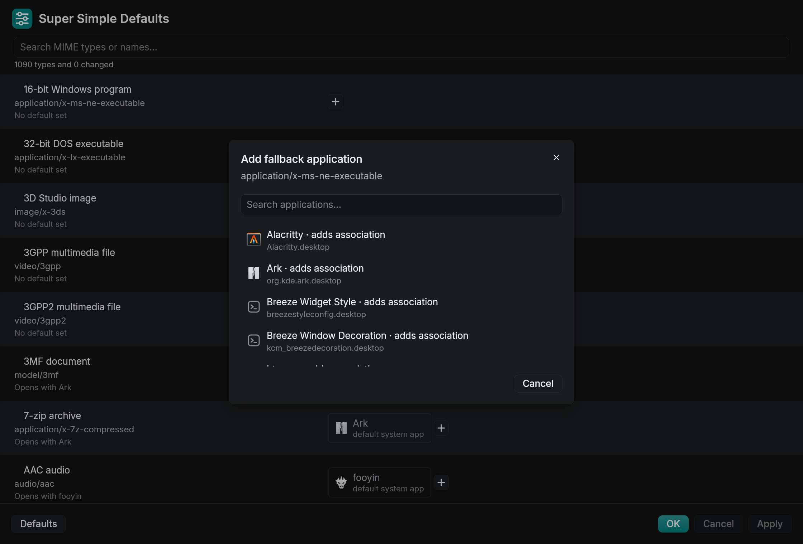

# Super Simple Defaults

A small native desktop application that helps you set default applications.\
Written in Rust with [Rune](https://github.com/anomalyco/rune), packaged for NixOS.



## Install

Add this repository as a flake input:

```nix
super-simple-defaults.url = "github:MiPSR/super-simple-defaults";
```

Then use the package, for example in `environment.systemPackages`:

```nix
inputs.super-simple-defaults.packages.x86_64-linux.default
```

## Run

NixOS only, other distributions are not supported for now.

```sh
nix run github:MiPSR/super-simple-defaults
```

If you already ran the app before, add `--refresh` to the command to get the newest version.

## Development

```sh
nix develop
cargo test
```

## AI

This app is mostly written by the AI tool [OpenCode](https://github.com/anomalyco/opencode), with minor human changes.

## Contributing

Any contribution is nice. If AI was used, say which tools and agents were used.
